# TP2 – Velocidade e Qualidade com Estruturas de Dados e Algoritmos em Python

Este repositório reúne a resolução do Teste de Performance 2 da disciplina **Velocidade e Qualidade com Estruturas de Dados e Algoritmos em Python**, do Instituto Infnet. Em 12 exercícios, o trabalho mostra como a escolha da estrutura de dados muda o custo de um algoritmo: otimização de soluções quadráticas com hash table, análise dos algoritmos de ordenação Selection Sort e Insertion Sort, implementação de pilha e fila e análise de funções hash. Cada exercício tem a resposta escrita e as evidências de execução (código e saída do programa).

**Autor:** Gustavo Mendes de Oliveira – Instituto Infnet

## Tecnologias

- Python 3
- Apenas a biblioteca padrão do Python (módulo `random` nos exercícios que geram listas de teste), sem dependências externas.

## Estrutura do repositório

```
.
├── README.md        textos, análises e prints de cada exercício
├── codigos/         um arquivo Python para cada exercício que tem código
└── prints/          capturas de tela do código e da execução
```

O Exercício 8 é uma análise escrita e não tem arquivo de código.

## Como executar

Os comandos abaixo são para macOS. A partir da raiz do repositório:

```
cd codigos
python3 ex01_maior_unico.py
```

Para os outros exercícios, basta trocar o nome do arquivo:

- Exercício 1: `python3 ex01_maior_unico.py`
- Exercício 2: `python3 ex02_intersecao_arrays.py`
- Exercício 3: `python3 ex03_primeiro_duplicado.py`
- Exercício 4: `python3 ex04_letra_ausente.py`
- Exercício 5: `python3 ex05_elemento_unico.py`
- Exercício 6: `python3 ex06_selection_sort.py`
- Exercício 7: `python3 ex07_insertion_sort.py`
- Exercício 9: `python3 ex09_stack.py`
- Exercício 10: `python3 ex10_queue.py`
- Exercício 11: `python3 ex11_reversao_string.py`
- Exercício 12: `python3 ex12_funcoes_hash.py`

---

## Exercício 1 – Maior número único: laços aninhados x hash table

Neste exercício resolvi o mesmo problema de duas formas: achar o maior número que aparece uma única vez numa lista.

Na primeira versão usei dois laços aninhados. Para cada número da lista, percorro a lista inteira de novo contando quantas vezes ele aparece. Se aparecer só uma vez, vejo se é o maior encontrado até agora. Instrumentei o código contando uma comparação a cada vez que o laço de dentro olha um elemento. Como são N números e cada um é comparado com os N da lista, o total dá sempre N × N.

Na versão otimizada usei um dicionário do Python como hash table. Percorro a lista uma única vez, guardando quantas vezes cada número aparece, e depois percorro só as entradas do dicionário procurando o maior com contagem 1. Para contar os acessos à estrutura, defini um critério e usei o mesmo em todos os testes: cada elemento da lista gera uma leitura e uma escrita no dicionário (dois acessos), e cada entrada visitada na segunda passada conta como um acesso. Comparação e acesso não são exatamente a mesma operação, mas como o critério é fixo, os números mostram bem como cada versão cresce quando a lista aumenta.

Testei com listas de 10 a 320 elementos em três cenários: todos os números distintos, muitos números repetidos e nenhum valor único (nesse caso o resultado é `None`). As duas versões deram o mesmo resultado em todos os casos. Quando o tamanho da lista dobra, as comparações da versão aninhada quadruplicam (100 com 10 elementos, 400 com 20, 1600 com 40 e assim por diante, até 102400 com 320). Já os acessos da versão com hash só dobram (30, 60, 120, até 960 no cenário de números distintos). Com 320 elementos, são mais de cem mil comparações contra menos de mil acessos.

Concluo que a versão com laços aninhados é O(N²) e a versão com hash table é O(N). Em troca, o dicionário usa memória extra proporcional à quantidade de números distintos, O(N) no pior caso, enquanto a primeira versão usa só algumas variáveis. É uma troca de memória por tempo, e nesse caso compensa bastante.

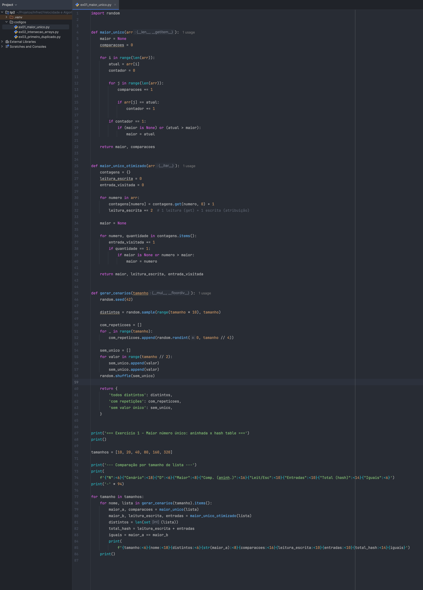

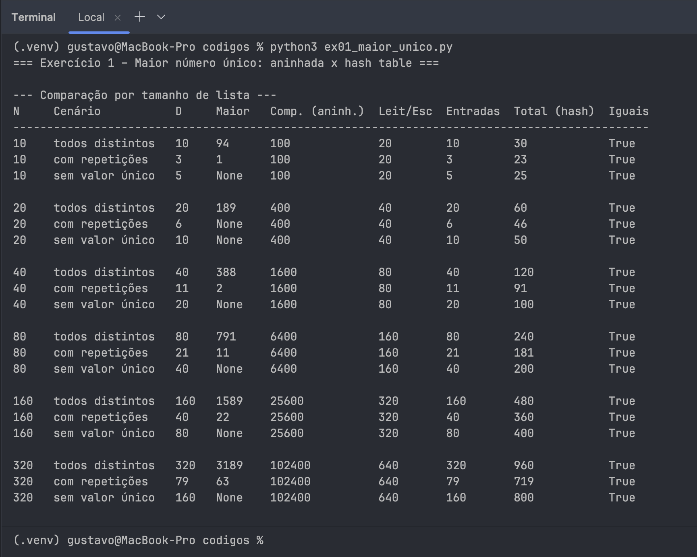

---

## Exercício 2 – Interseção de arrays com hash table

A função recebe dois arrays e devolve os elementos em comum, sem usar nenhuma função pronta de interseção. Primeiro guardo o primeiro array num dicionário que conta quantas vezes cada elemento aparece. Depois percorro o segundo array e, para cada elemento, vejo se ele ainda tem contagem disponível no dicionário. Se tem, diminuo essa contagem e registro o elemento no resultado, que também é um dicionário com a quantidade de vezes que cada elemento é comum.

Esse controle de contagem serve para tratar repetições, porque um elemento só é comum tantas vezes quanto aparece nos dois arrays. No caso de teste com repetições, por exemplo, o 9 aparece quatro vezes no primeiro array e cinco no segundo, então ele vale quatro no resultado.

Cada array é percorrido uma única vez, e cada consulta ou alteração no dicionário leva, em média, tempo constante. Não há laço dentro de laço, então o custo é proporcional ao total de elementos dos dois arrays, ou seja, O(N).

Para validar, construí os arrays de modo que o resultado fosse conhecido antes de rodar: o primeiro vai de 0 a N−1 e o segundo de N/2 a N+N/2−1. Assim, os elementos em comum são exatamente os de N/2 a N−1, cada um uma vez, o que dá N/2 elementos. Testei com N de mil até um milhão e, em todos os tamanhos, o resultado obtido bateu com o esperado. Também conferi um caso menor com repetições, que também bateu.

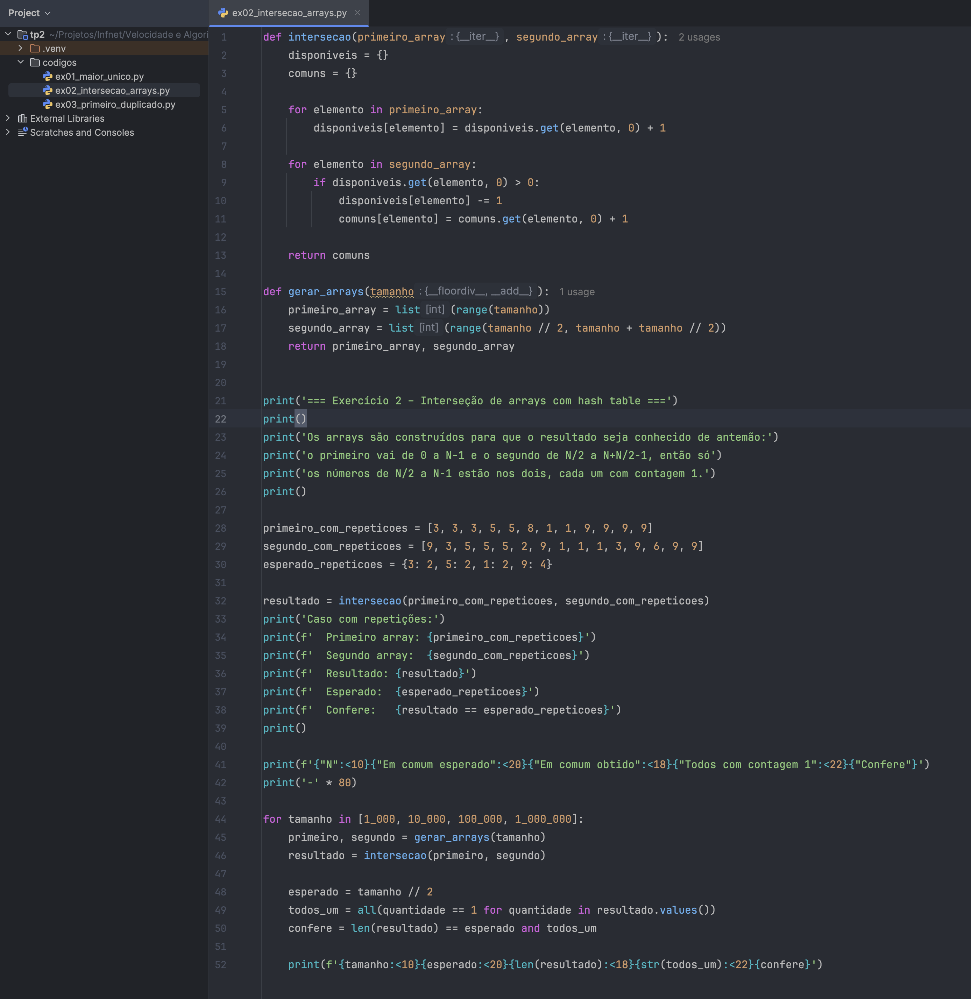

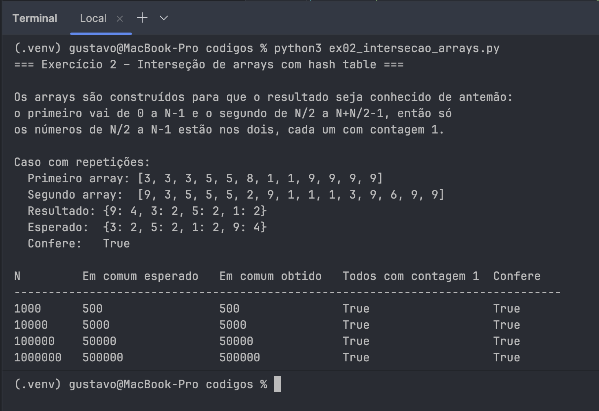

---

## Exercício 3 – Primeiro valor duplicado

Para achar o primeiro valor duplicado, percorro o array da esquerda para a direita com um dicionário que guarda os valores que já vi. Para cada string, pergunto se ela já está no dicionário. Se estiver, é o primeiro duplicado e a função retorna na hora. Se não estiver, guardo e sigo para o próximo.

Como a leitura é sequencial e para na primeira repetição, a ordem é preservada e nada é reprocessado. Vale notar o que "primeiro duplicado" significa aqui: é o valor cuja segunda aparição chega antes. Em `['a', 'b', 'b', 'a']`, por exemplo, o resultado é `'b'`, porque ele se repete antes do `'a'`.

Cada elemento é visitado uma vez, e consultar ou inserir no dicionário leva tempo constante em média, então a execução é O(N). A memória extra também é O(N) no pior caso, já que o dicionário pode chegar a guardar todos os elementos.

Testei com duplicado no meio, duplicado no fim, duplicados vizinhos, maiúsculas distintas (`'Ana'` e `'ana'` são strings diferentes, então só `'Bia'` se repete), um array grande com mais de dez mil elementos e um array sem duplicados, que devolve `None`. Esse último caso foge da premissa do enunciado, mas mostra que a função não quebra quando não há repetição. Todos os resultados conferiram com o esperado.

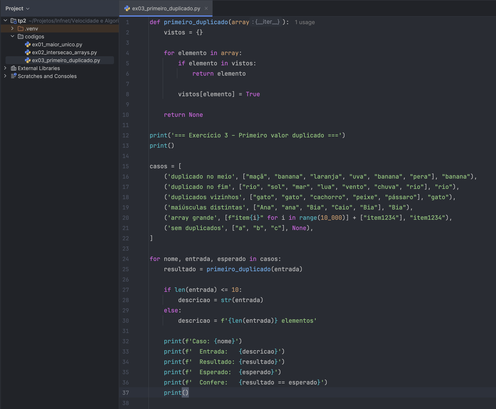

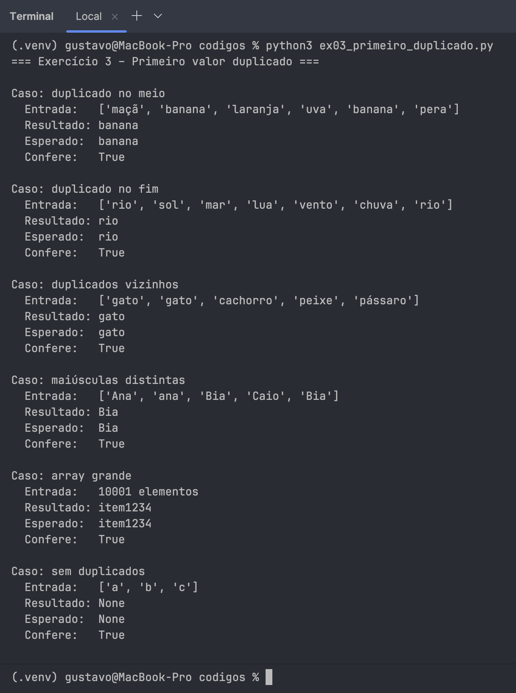

---

## Exercício 4 – Letra ausente do alfabeto

Para descobrir quais letras do alfabeto faltam numa string, uso um dicionário de presença com as 26 letras de a a z, todas começando como `False`. Depois percorro o texto, já convertido para minúsculas, e marco como `True` cada letra que encontro. Espaços, números e pontuação são ignorados, porque só marco o que já existe no dicionário. No final, percorro o dicionário e junto numa lista as letras que continuaram `False`. A função devolve todas as letras ausentes, não só uma, porque pode faltar mais de uma.

Em termos de Big O, são três laços um depois do outro, e nenhum dentro de outro: um de 26 passos para montar o dicionário, um que percorre o texto (N caracteres) e outro de 26 passos para coletar as ausentes. Isso dá 26 + N + 26. Como o 26 é fixo e não cresce com o texto, o que manda é o N, então o tempo é O(N). A memória extra também não cresce com a entrada, porque o dicionário tem sempre 26 posições, então é O(1).

Testei com seis casos: três letras só, uma letra repetida, um pangrama completo (nenhuma letra ausente), uma frase em maiúsculas faltando só o g, um texto com números, vírgula e exclamação misturados e uma string vazia, em que as 26 letras ficam ausentes. Em todos, o resultado bateu com o esperado.

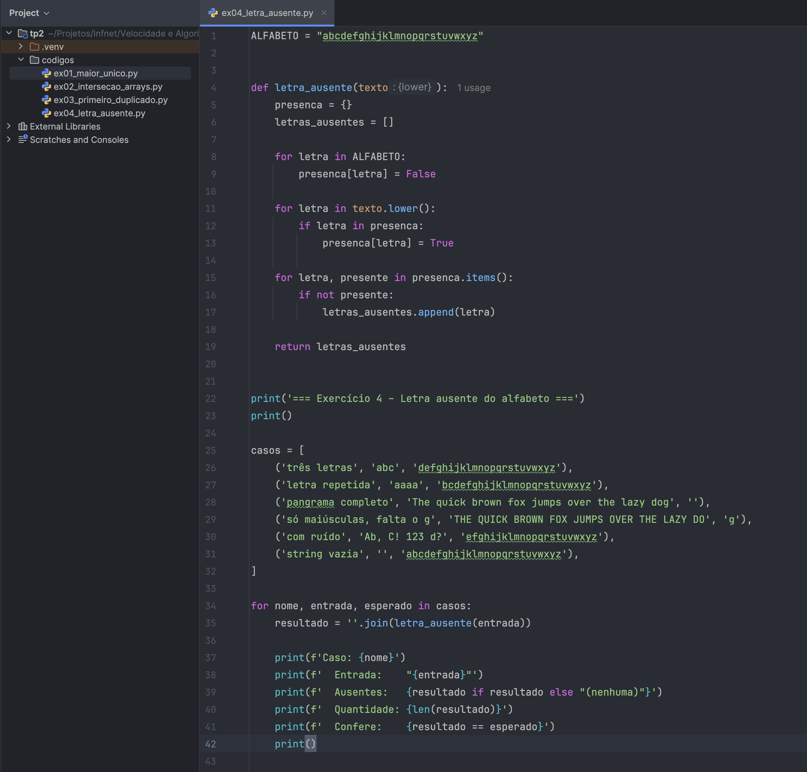

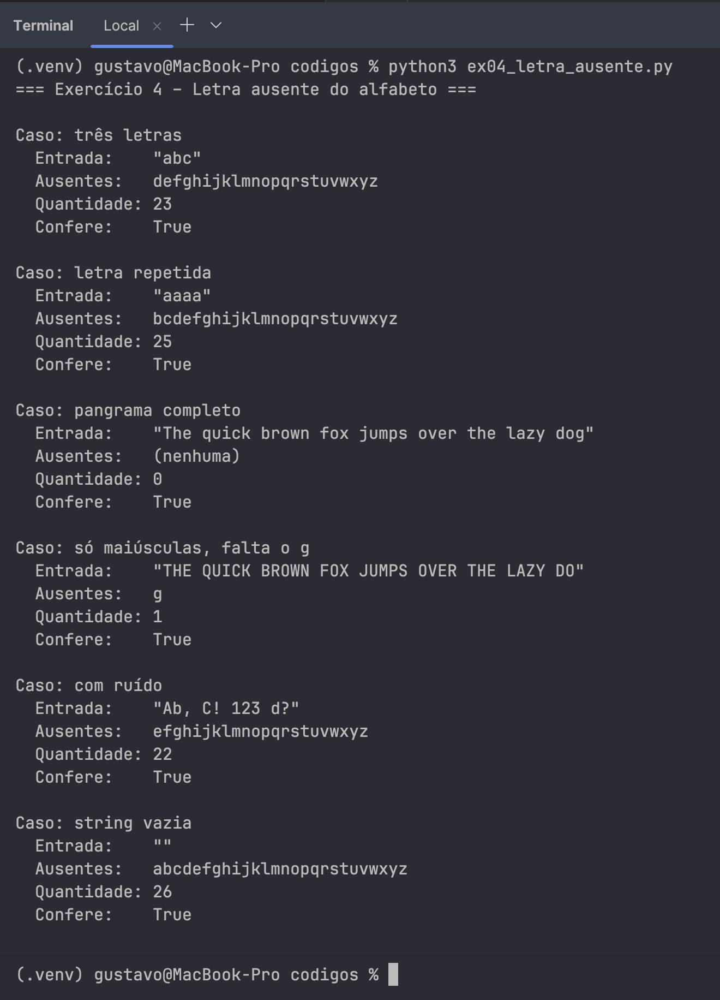

---

## Exercício 5 – Primeiro caractere não repetido

Aqui separei a contagem da verificação, em dois laços seguidos. No primeiro, percorro a string e conto num dicionário quantas vezes cada caractere aparece. No segundo, percorro a string de novo, na ordem original, e retorno o primeiro caractere cuja contagem é 1. Se nenhum caractere tiver contagem 1, a função devolve `None`.

Percorrer a string original no segundo laço, e não o dicionário, é o que garante que a ordem de leitura seja respeitada. Por exemplo, em `"abacbd"` os caracteres `c` e `d` aparecem uma vez só, mas o resultado é `c` porque ele vem primeiro.

São duas passadas independentes, uma de contagem e outra de verificação, cada uma com N passos, e consultar o dicionário leva tempo constante em média. O custo total é de 2N, que em Big O é O(N). A memória extra é a do dicionário, que guarda uma entrada por caractere diferente e, no pior caso, pode chegar a N.

Testei com dez casos, entre eles um único e um repetido, o primeiro caractere repetido, dois únicos (vale o primeiro), único no fim, maiúscula e minúscula (`"Aa"` dá `A`, porque são caracteres diferentes), um caractere só, todos repetidos e string vazia (esses dois devolvem `None`) e uma string com mais de duzentos mil caracteres. Todos conferiram.

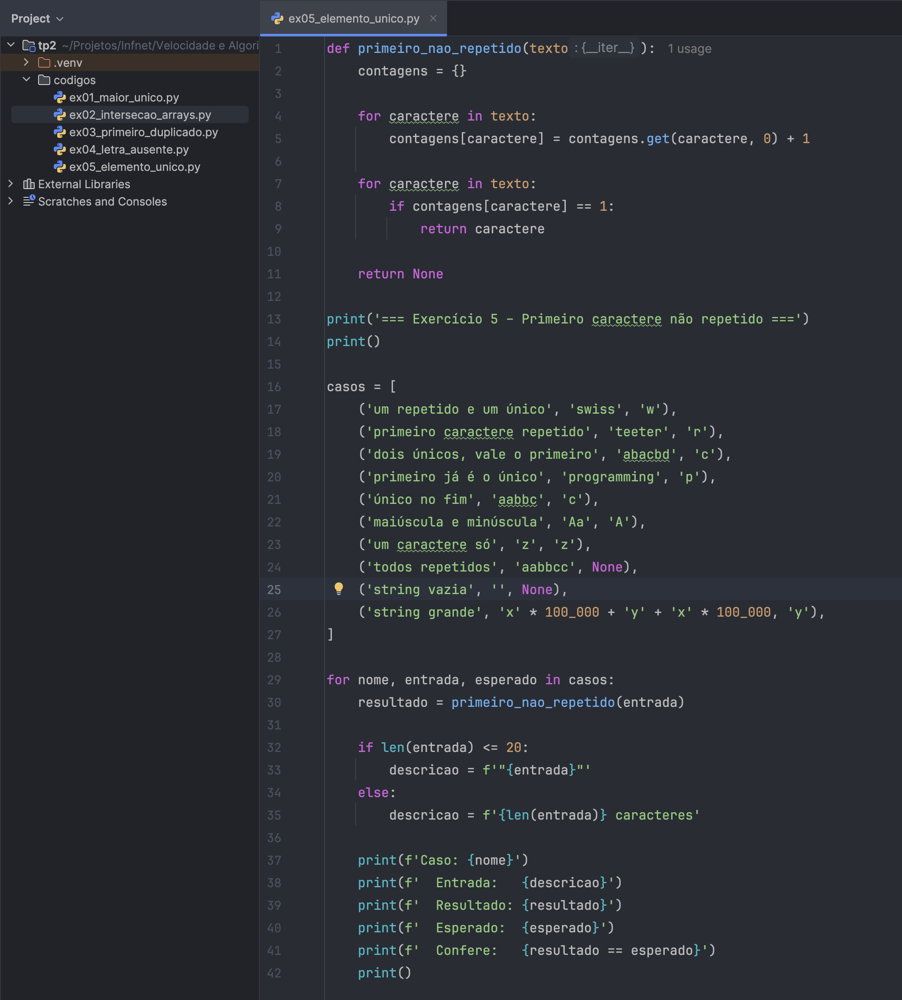

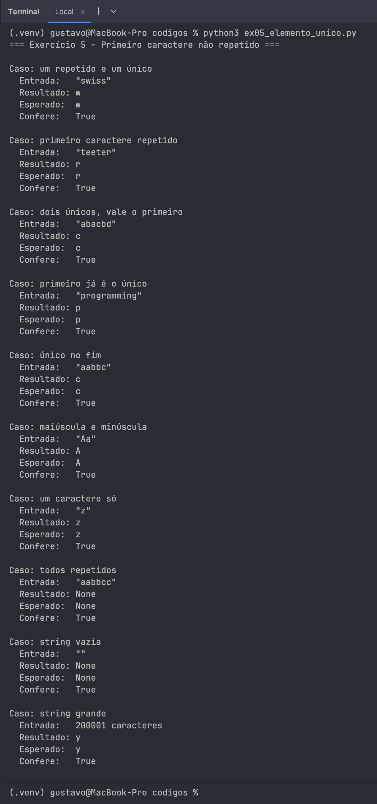

---

## Exercício 6 – Selection Sort

O Selection Sort funciona assim: para cada posição da lista, procuro o menor elemento entre os que ainda não foram ordenados e troco ele com o que está nessa posição. Assim, a parte da esquerda vai ficando ordenada a cada passo. Implementei sem nenhuma função pronta de ordenação e instrumentei duas contagens: comparações (cada vez que olho um elemento para ver se é o menor) e trocas (só conto quando de fato mudo dois elementos de lugar).

Rodei o algoritmo com listas de 100, 200 e 400 elementos em três estados iniciais: aleatória, já ordenada e invertida. As comparações deram exatamente o mesmo número nos três estados: 4950 para 100 elementos, 19900 para 200 e 79800 para 400. Isso acontece porque, para cada posição, o algoritmo sempre olha todos os elementos que sobram, mesmo que a lista já esteja ordenada. O total é sempre N × (N − 1) / 2, e quando o tamanho dobra, as comparações quase quadruplicam.

Já as trocas variam com o estado inicial. Na lista já ordenada não houve nenhuma troca. Na invertida, foi metade do tamanho da lista (50, 100 e 200), porque cada troca já coloca dois elementos no lugar certo. Na aleatória ficou perto de N (97, 190 e 395). No máximo, o algoritmo faz N − 1 trocas.

Em Big O, o Selection Sort é O(N²) em todos os casos, melhor, médio e pior, porque o número de comparações não depende de como os dados estão. Em todas as execuções, a lista saiu ordenada, como confirmei comparando o resultado com a lista ordenada de referência.

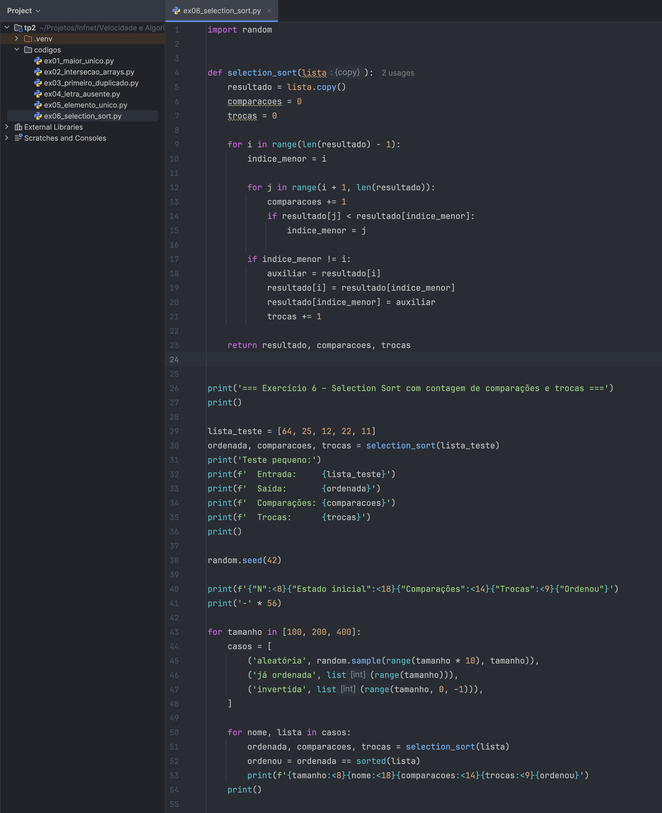

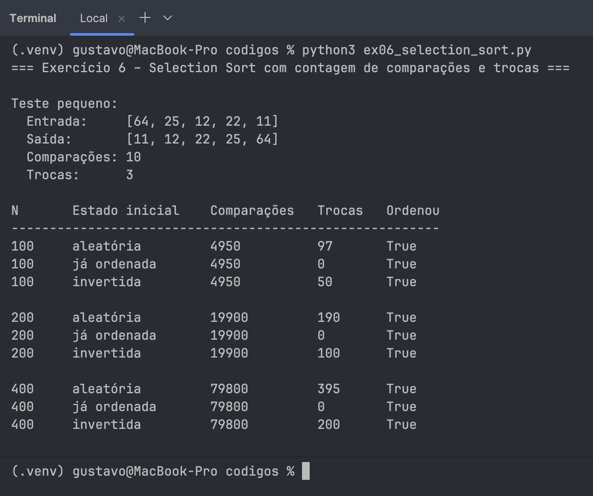

---

## Exercício 7 – Insertion Sort

O Insertion Sort pega um elemento de cada vez, da esquerda para a direita, e o encaixa no lugar certo dentro da parte que já está ordenada. Para abrir espaço, os elementos maiores que ele vão sendo deslocados uma posição para a direita, até aparecer um elemento menor ou igual, ou o começo da lista. Instrumentei as comparações (cada vez que comparo o elemento com um vizinho da esquerda) e os deslocamentos (cada vez que empurro um elemento para a direita).

Testei com listas de 100, 200 e 400 elementos em três estados: já ordenada, quase ordenada (ordenada, mas com alguns pares vizinhos trocados de lugar, um a cada 20 posições) e invertida. Os resultados foram bem diferentes entre si:
- **Já ordenada:** N − 1 comparações e nenhum deslocamento (99, 199 e 399 comparações). Cada elemento é comparado só com o vizinho da esquerda e já fica onde está.
- **Quase ordenada:** poucas comparações a mais que no caso anterior (103, 208 e 418) e poucos deslocamentos (5, 10 e 20), só os dos pares trocados.
- **Invertida:** o pior caso. As comparações e os deslocamentos foram iguais (4950, 19900 e 79800), porque cada elemento precisa passar por todos os que estão à esquerda dele.

Isso dá o custo computacional: no melhor caso, com a lista já ordenada, o algoritmo é O(N), já que faz só uma comparação por elemento. No pior caso, com a lista invertida, é O(N²). Na prática, o custo acompanha o quanto a lista está desordenada, e por isso o Insertion Sort é eficiente em listas quase ordenadas. Isso o diferencia do Selection Sort, que fez as mesmas 4950 comparações para 100 elementos mesmo com a lista já ordenada, enquanto o Insertion Sort fez 99.

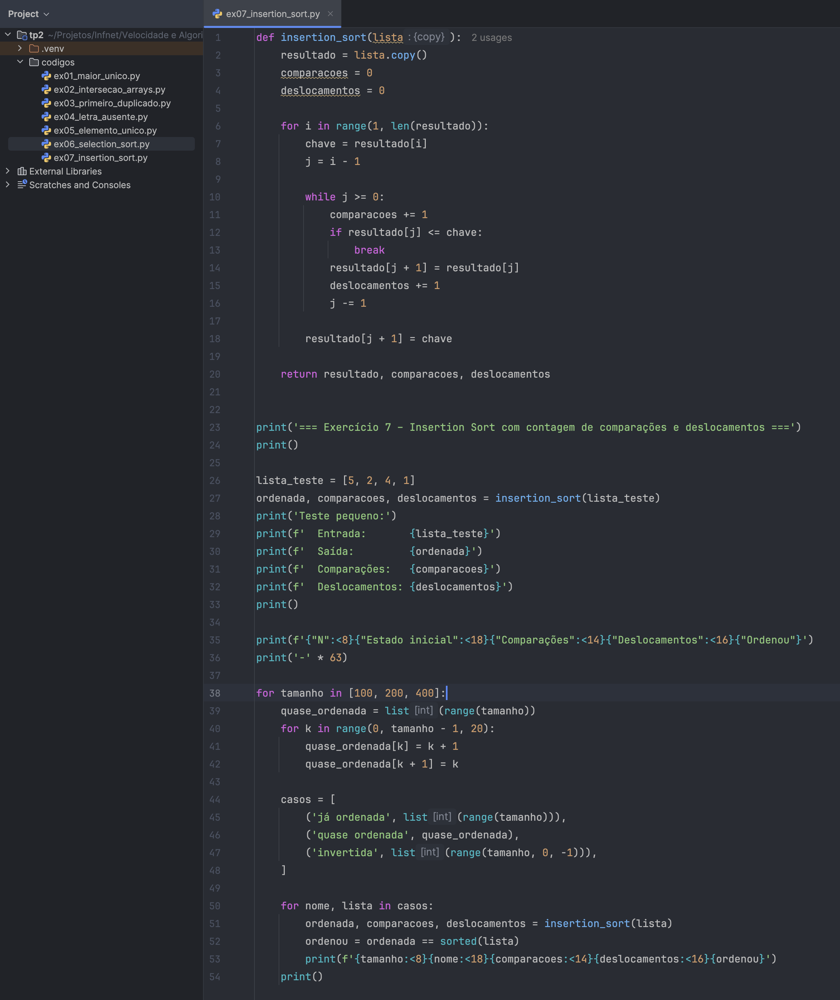

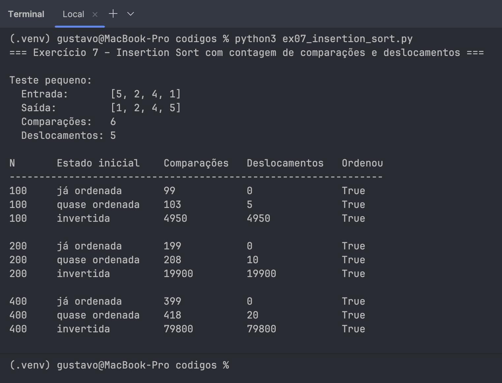

---

## Exercício 8 – Escolha entre pilha e fila

Pensando num sistema que atende as solicitações estritamente na ordem em que chegam, a minha escolha é a **fila**.

A diferença entre as duas estruturas está na regra de acesso. Na fila, o primeiro a entrar é o primeiro a sair (FIFO). Na pilha é o contrário: o último a entrar é o primeiro a sair (LIFO). Como o sistema precisa atender por ordem de chegada, a fila já faz exatamente isso, sem eu precisar adaptar nada.

Se eu imaginar três solicitações chegando, A, depois B e depois C, a fila atende A, B, C, como o sistema pede. A pilha atenderia C, B, A, e a mais recente passaria na frente de todas as outras. Isso ainda traz um problema prático: enquanto chegarem solicitações novas, a primeira pode ficar esperando indefinidamente, porque sempre vai ter alguém mais novo na frente dela. Na fila, cada solicitação espera só pelas que chegaram antes.

As operações envolvidas são estas:

- **Enfileirar (enqueue):** coloca uma nova solicitação no final da fila. É o que acontece quando alguém chega.
- **Desenfileirar (dequeue):** retira e devolve a solicitação que está no início da fila. É o atendimento propriamente dito.
- **Consultar o início (front):** mostra qual é a próxima solicitação a ser atendida, sem retirá-la.
- **Verificar se está vazia (is_empty):** indica se não há ninguém esperando, o que evita tentar atender uma fila sem solicitações.

Outra vantagem é o custo. Se a fila guardar onde está o início e onde está o fim, entrar e sair levam sempre o mesmo tempo, não importa quantas solicitações estejam esperando, porque não preciso reorganizar nada, só mover essas marcações. É o que acontece, por exemplo, numa fila de atendimento ou em requisições chegando a um servidor.

---

## Exercício 9 – Pilha com capacidade fixa e controle de erros

Implementei a pilha como uma classe `Stack` baseada em array: ao criar a pilha, uma lista com o tamanho da capacidade é preenchida com `None`, e a pilha trabalha dentro dela, sem nunca crescer. Além do array, a classe guarda a capacidade e o tamanho atual. O tamanho tem duas funções ao mesmo tempo: diz quantos elementos a pilha tem e aponta para a próxima posição livre.

Para empilhar, escrevo o valor na posição indicada pelo tamanho e depois aumento o tamanho. Para desempilhar, faço o contrário: diminuo o tamanho primeiro, porque aí ele passa a apontar para o último elemento, guardo esse valor, limpo a posição (volta a `None`) e devolvo o valor. O método `topo` só espia o último elemento, sem remover.

O controle de erros é explícito. Antes de empilhar, a pilha confere se está cheia e, se estiver, levanta um erro de overflow. Antes de desempilhar (e de consultar o topo), confere se está vazia e, se estiver, levanta um erro de underflow. Na demonstração, esses erros são capturados com `try` e `except`, então o programa não é interrompido e mostra a mensagem. Depois do erro, o estado da pilha continua igual, o que confirma que a tentativa inválida não estragou nada.

Sobre a persistência de estado, que o enunciado destaca: a pilha mantém o array e o tamanho como atributos do próprio objeto, então eles continuam existindo entre uma operação e outra e não são recriados a cada chamada. Cada operação só mexe nesse estado. Todas as operações têm custo constante, O(1), porque só mexem na posição do topo.

A demonstração usa uma pilha de capacidade 3: empilho 10, 20 e 30, tento empilhar 40 (overflow), consulto o topo, desempilho os três valores (saem 30, 20 e 10, na ordem inversa da entrada) e tento desempilhar uma quarta vez (underflow). Depois de cada etapa, o programa imprime o estado interno, com o conteúdo do array, o tamanho e a capacidade.

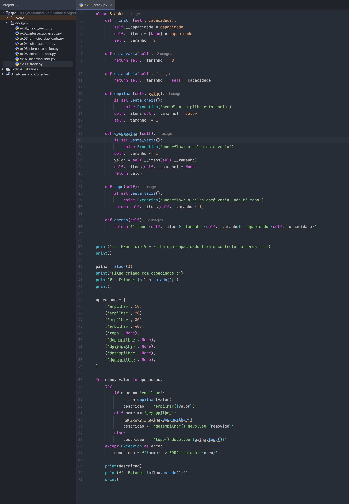

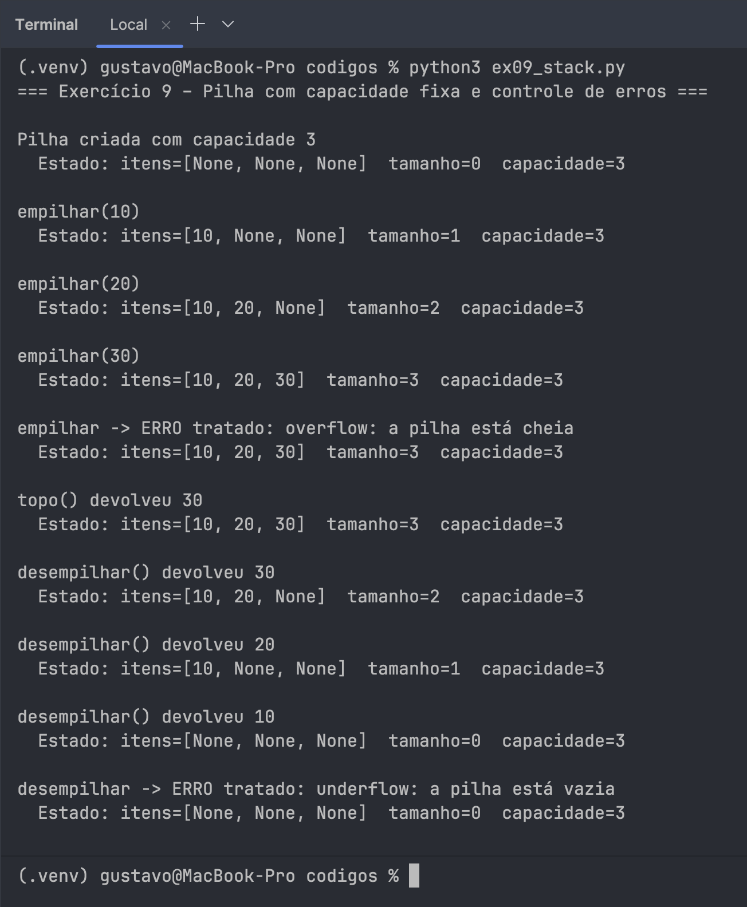

---

## Exercício 10 – Fila com ponteiros

A fila também é uma classe de capacidade fixa, com um array interno e três controles: `inicio`, que aponta para o próximo elemento a sair, `fim`, que aponta para a próxima posição livre, e `tamanho`, que conta quantos elementos há. Para enfileirar, escrevo o valor na posição de `fim` e avanço `fim`. Para desenfileirar, leio o valor na posição de `inicio`, limpo essa posição e avanço `inicio`. Nenhum elemento é movido de lugar, só os ponteiros andam, então as duas operações têm custo constante, O(1).

Quando um ponteiro chega ao final do array, ele volta para o começo, o que se faz com o resto da divisão pela capacidade. Isso torna a fila circular e permite reaproveitar as posições que ficaram livres. Dá para ver isso na demonstração: depois de sair o A e o B, os valores D e E entram nas posições 0 e 1 do array, que ficaram vazias, e a fila continua funcionando normalmente.

O `tamanho` é necessário porque, só olhando os ponteiros, não dá para distinguir uma fila cheia de uma fila vazia: nos dois casos `inicio` e `fim` apontam para a mesma posição. A demonstração mostra isso nos dois momentos, com a fila cheia (`inicio=0` e `fim=0`) e com a fila vazia (`inicio=2` e `fim=2`). Com o tamanho, a verificação é direta: vazia quando ele é 0 e cheia quando é igual à capacidade.

Overflow e underflow são tratados como na pilha, com erros explícitos capturados por `try` e `except`. A demonstração usa capacidade 3, enfileira A, B e C, tenta enfileirar o X (overflow), consulta a frente, remove dois, enfileira D e E, remove tudo e tenta remover mais uma vez (underflow). O estado interno é impresso depois de cada operação.

Para validar o comportamento FIFO, guardei a ordem de entrada (A, B, C, D, E) e a ordem em que os elementos saíram e comparei as duas. Saíram na mesma ordem em que entraram, então o primeiro a entrar foi sempre o primeiro a sair.

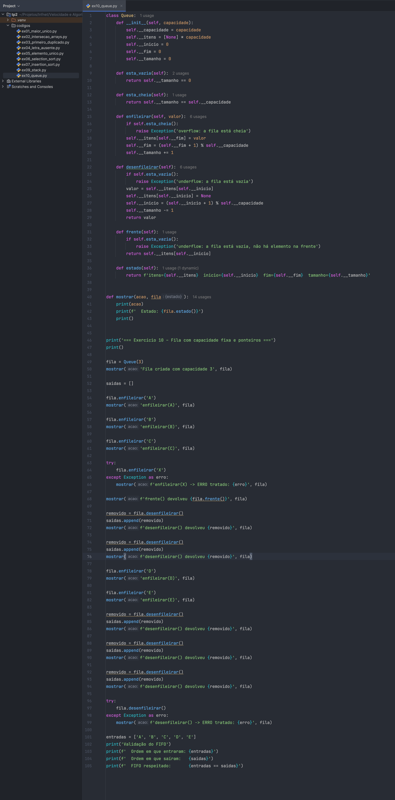

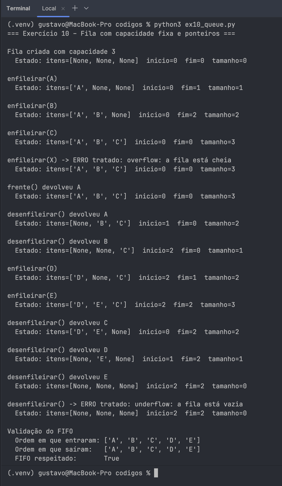

---

## Exercício 11 – Reversão de string utilizando pilha

Para inverter a string, criei uma classe `Pilha` simples, que guarda os elementos numa lista do Python e só tem as operações de empilhar e desempilhar, com erro de underflow quando se tenta desempilhar uma pilha vazia. Diferente da pilha do exercício anterior, esta não tem capacidade fixa, porque aqui ela só precisa servir de apoio para a inversão.

A função tem dois laços, um depois do outro. No primeiro, percorro a string da esquerda para a direita e empilho cada caractere. No segundo, enquanto a pilha não estiver vazia, desempilho e vou juntando cada caractere numa string nova. A inversão acontece por conta da própria pilha: o último caractere empilhado é o primeiro a sair, então os caracteres saem na ordem contrária da entrada. Não usei slicing nem nenhuma função pronta de reversão.

Cada caractere é empilhado uma vez e desempilhado uma vez, então o tempo é O(N). A pilha chega a guardar todos os caracteres ao mesmo tempo, então a memória extra também é O(N).

Testei com uma palavra simples, uma frase com espaços, uma palavra com acento, uma string com números e símbolos, um palíndromo (que sai igual), um caractere só, uma string vazia e uma string longa com mil caracteres, montada para que o resultado esperado fosse conhecido de antemão. Todos os resultados bateram com o esperado.

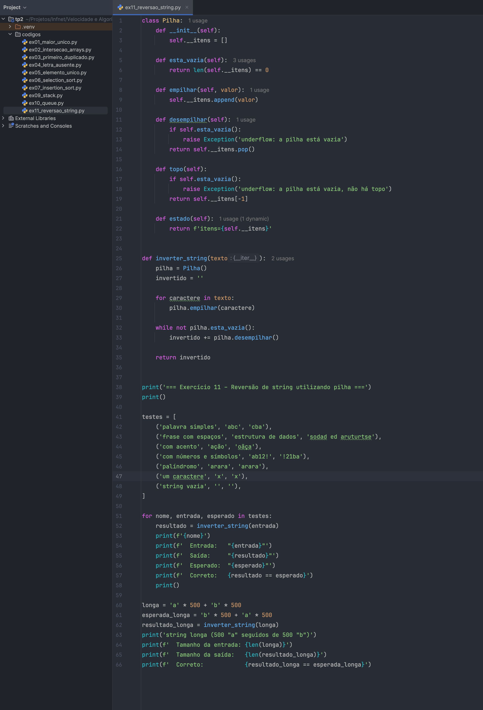

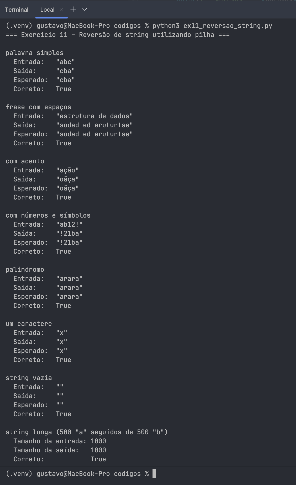

---

## Exercício 12 – Análise de funções hash e distribuição

Uma função hash decide em qual posição da tabela cada chave vai ficar. Se ela espalha as chaves de forma parelha, a busca é rápida. Se muitas chaves caem na mesma posição, acontecem colisões, e a busca passa a depender de percorrer essas chaves acumuladas. Neste exercício analisei três funções para uma tabela com M = 10 posições, calculando para onde cada uma manda as chaves.

Um ponto vale para as três: elas só dependem do **último dígito** da chave. Qualquer número k pode ser escrito como dez vezes alguma coisa mais o último dígito d, e na hora de tirar o resto da divisão por 10, a parte múltipla de 10 desaparece. Então 47 e 7 caem sempre na mesma posição nas três funções.

Posição de cada chave de 0 a 9 em cada função:

| k | 0 | 1 | 2 | 3 | 4 | 5 | 6 | 7 | 8 | 9 |
|---|---|---|---|---|---|---|---|---|---|---|
| h₁ | 0 | 1 | 2 | 3 | 4 | 5 | 6 | 7 | 8 | 9 |
| h₂ | 0 | 7 | 4 | 1 | 8 | 5 | 2 | 9 | 6 | 3 |
| h₃ | 0 | 1 | 4 | 9 | 6 | 5 | 6 | 9 | 4 | 1 |

A **h₁**, que é k mod 10, usa o próprio último dígito como posição. Com as chaves de 0 a 9, cada uma cai numa posição diferente. Com as chaves de 0 a 99, cada posição recebe exatamente 10, uma distribuição perfeita.

A **h₂**, que é (k × 7) mod 10, parece diferente, mas se comporta igual à h₁. Para as chaves de 0 a 9, ela gera as posições 0, 7, 4, 1, 8, 5, 2, 9, 6, 3, ou seja, todas as dez posições, cada uma uma vez, só em outra ordem. Isso acontece porque 7 e 10 não têm nenhum divisor em comum. Por isso, se duas chaves distintas de 0 a 9 caíssem na mesma posição, a diferença entre elas teria de ser múltipla de 10, o que é impossível entre 0 e 9. A h₂ apenas embaralha as posições da h₁, sem melhorar nem piorar a distribuição.

A **h₃**, que é k² mod 10, é a pior das três. Os quadrados de 0 a 9 são 0, 1, 4, 9, 16, 25, 36, 49, 64 e 81, e os últimos dígitos são 0, 1, 4, 9, 6, 5, 6, 9, 4, 1. Nenhum quadrado perfeito termina em 2, 3, 7 ou 8, então essas quatro posições nunca são usadas, o que desperdiça 40% da tabela. Além disso, k e 10 − k sempre colidem, porque (10 − k)² e k² dão o mesmo resto na divisão por 10. Por isso, 1 colide com 9, 2 com 8, 3 com 7 e 4 com 6. Com as chaves de 0 a 99, a h₃ usou só 6 posições: quatro receberam 20 chaves, duas receberam 10 e as outras ficaram vazias.

Para ver o efeito dos padrões nas chaves, testei quatro conjuntos de 0 a 99. Com as chaves consecutivas, h₁ e h₂ distribuíram perfeitamente e a h₃ concentrou tudo em 6 posições. Com os números pares, h₁ e h₂ usaram só 5 posições (as pares) e a h₃, só 3. Com os múltiplos de 5, as três usaram só 2 posições. Com os múltiplos de 10, as três mandaram todas as chaves para a posição 0. Esse último é o pior caso possível: uma tabela com tudo na mesma posição vira praticamente uma lista, e a busca, que deveria ser O(1), passa a ser O(N).

Resumo dos conjuntos testados, cada um com chaves entre 0 e 99:

| Conjunto de chaves | Posições usadas (h₁ / h₂ / h₃) | Maior ocupação (h₁ / h₂ / h₃) |
|---|---|---|
| 0 a 99 (consecutivas) | 10 / 10 / 6 | 10 / 10 / 20 |
| Números pares | 5 / 5 / 3 | 10 / 10 / 20 |
| Múltiplos de 5 | 2 / 2 / 2 | 10 / 10 / 10 |
| Múltiplos de 10 | 1 / 1 / 1 | 10 / 10 / 10 |

Concluo que a h₃ é a de maior risco de colisão, porque mesmo com chaves consecutivas e sem nenhum padrão ela já desperdiça posições e gera colisões. A h₁ e a h₂ são equivalentes em qualidade: ótimas com chaves consecutivas, mas ruins quando as chaves têm padrão. O problema que as três têm em comum vem do tamanho da tabela, já que 10 é divisível por 2 e por 5, e chaves que compartilham esses fatores acabam se concentrando em poucas posições. A qualidade de uma função hash, então, depende tanto da fórmula quanto do tamanho da tabela e do tipo de chave que chega.

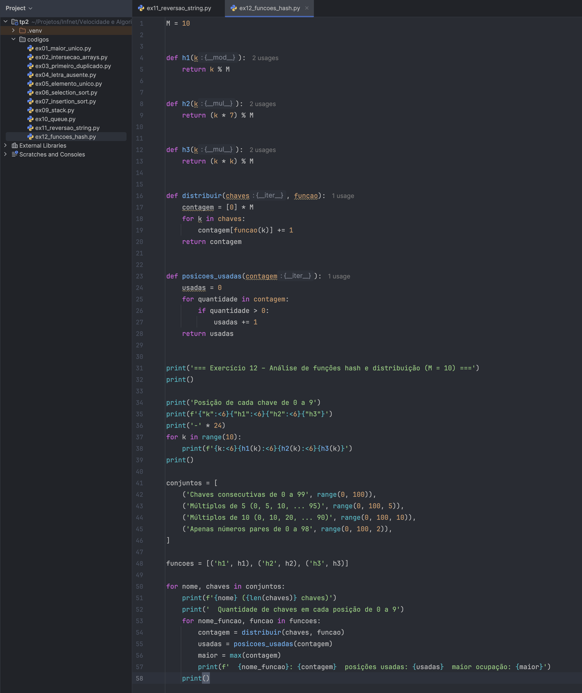

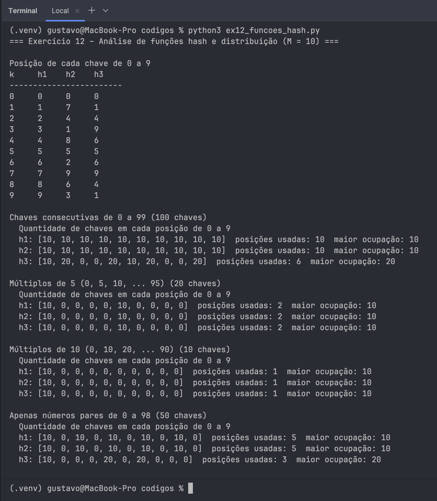
